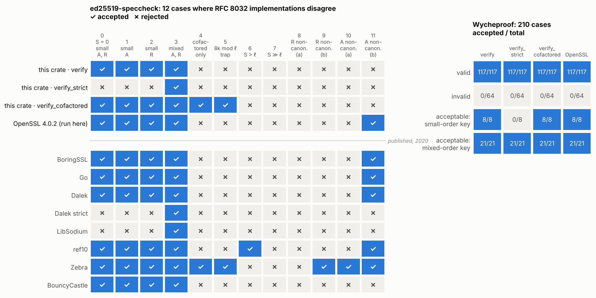
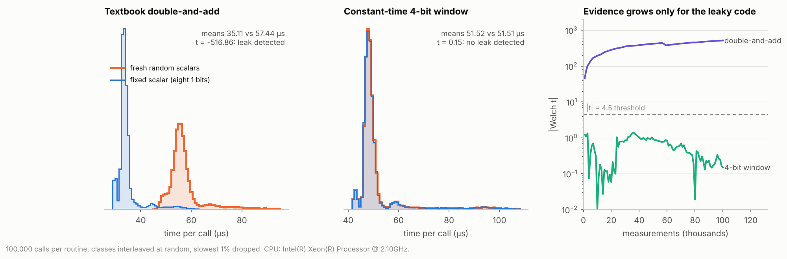
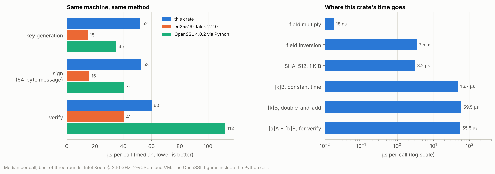

# ed25519-rs

Ed25519 signatures (RFC 8032) built from first principles in Rust: SHA-512,
arithmetic modulo 2^255 − 19, the twisted Edwards group and scalars modulo the
group order. No dependencies and no standard library. The only `unsafe` is the
one volatile write that wipes secret keys on drop.

> **Not audited. This is a study implementation.** For anything real, use a
> maintained library such as `ed25519-dalek`, libsodium or your platform's
> crypto API.

```rust
use ed25519_rs::SigningKey;

let key = SigningKey::from_seed(&seed);          // seed: 32 bytes from a CSPRNG
let signature = key.sign(b"message");
key.verifying_key().verify(b"message", &signature)?;
```

## What the tests establish

| Claim | Evidence | Grade |
|---|---|---|
| Keys and signatures match the reference byte for byte | 128/128 SUPERCOP `sign.input` vectors, including RFC 8032 TEST 1–3; 50/50 signatures made by OpenSSL 4.0.2 for messages of 0–2,048 bytes | proven by test |
| Verification gets the edge cases right | Wycheproof: all 117 valid cases accepted and all 64 invalid cases rejected, under each of the three verification rules; all 12 speccheck cases give the documented answer | proven by test |
| The building blocks are correct | Checked against Python integers and `hashlib`: 352 field cases, 721 scalar cases, SHA-512 at every length 0–300 and on a million `a`, 310 point decodings (159 of them must fail), 56 base-point multiples | proven by test |
| Secret-scalar multiplication does not leak timing | dudect-style test, 100,000 calls: \|t\| stays at or below 1.4 against a threshold of 4.5, while the textbook routine reaches \|t\| = 517 | plausible: one test on one machine, not a proof |
| Speed | sign 53 µs, verify 60 µs: about 3.3× slower than ed25519-dalek to sign and 1.5× slower to verify | measured on one cloud VM |

## Three verification rules, and why there are three

RFC 8032 allows more than one verification equation, and real libraries
disagree on the corner cases. Chalkias, Garillot and Nikolaenko collected
twelve such cases ("Taming the many EdDSAs", SSR 2020). This crate offers three
rules, and the tests pin down how each one treats every case:

| method | accepts when | also rejects |
|---|---|---|
| `verify` | `[S]B = R + [k]A` | S ≥ ℓ, a non-canonical encoding of A or R |
| `verify_strict` | `[S]B = R + [k]A` | the same, plus small-order A or R |
| `verify_cofactored` | `[8]([S]B − [k]A − R) = 0` | S ≥ ℓ, a non-canonical encoding of A or R |



*Top rows: this crate and OpenSSL 4.0.2, run here. Lower rows: as published in
the ed25519-speccheck README (2020). Cases 8–11 encode the point (0, −1) with
the sign bit set: in (a) the signer hashed the canonical re-encoding, in (b)
the bytes as given.*

What the figure shows:

- **The plain rule accepts a universal forgery.** The identity point is a valid
  public key, and for it `[k]A` vanishes, so a signature with R = [S]B passes
  for *every* message. Wycheproof includes this case (tcId 152), and
  `tests/wycheproof.rs` checks that one signature verifies for three different
  messages under `verify`. `verify_strict` refuses small-order keys and closes
  the hole.
- **`verify` matches BouncyCastle's published row exactly.** It differs from
  Dalek, Go, BoringSSL and OpenSSL only on case 11, where those accept a public
  key that encodes x = 0 with the sign bit set. RFC 8032 section 5.1.3 says
  that decoding must fail.
- **`verify_strict` matches the published rows for Dalek's `verify_strict` and
  libsodium.**
- **Of the three rules, only `verify_cofactored` accepts cases 4 and 5**, as
  Zebra does. It multiplies by 8 last. Reducing 8k modulo ℓ first, the trap in case 5, would
  give a different answer for keys with a torsion component.
- In the published table, the original ref10 code accepts case 6 (S just
  above ℓ), so its signatures were malleable. This crate rejects any S ≥ ℓ.

## Constant time

Signing must not take a different amount of time for different secret keys or
nonces. Otherwise someone timing it can learn the secret. In the signing path:

- `[k]B` uses a fixed 4-bit window: 64 rounds of four doublings and one
  addition, with the table entry fetched by reading all 16 entries and keeping
  one through a mask. The work and the memory accesses are the same for every k.
- Field arithmetic has no branches. Scalar reduction is Barrett's method with
  the final corrections done by masks.
- Rust gives no constant-time guarantee: an optimiser may turn a mask back into
  a branch. `core::hint::black_box` discourages that, so the result is checked
  by measurement rather than assumed.

The check follows dudect (Reparaz, Balasch, Verbauwhede, DATE 2017). It times
100,000 calls, each with either one fixed sparse scalar or a fresh random one,
in random order. Welch's t-test then compares the two groups.



The textbook double-and-add, which adds only on 1 bits, takes 35.1 µs on the
sparse scalar and 57.4 µs on random ones (t = −517). The windowed routine takes
51.52 µs and 51.51 µs (t = 0.15). |t| stays below 1.4 throughout, and the
final t is 1.9 even with the slowest 1% of calls kept in. A large t is
proof of a leak; a small t is only the absence of evidence, from one machine and
one compiler. It says nothing about power or electromagnetic side channels.
Verification handles only public data, so it uses faster variable-time code.

## Performance



Median time per call, best of three rounds, on a 2-vCPU cloud VM (Intel Xeon at
2.10 GHz). ed25519-dalek 2.2.0 was measured with the same harness
(`scripts/compare_dalek`). OpenSSL was measured through Python, which adds a
small overhead to every call. Its slow verify is not that overhead: `openssl speed
ed25519` with the system's OpenSSL 3.0.13 gives 43 µs to sign and 120 µs to
verify on the same machine.

Why this crate is slower than dalek:

- **Signing.** dalek computes [r]B from a precomputed table of base-point
  multiples, which needs only four doublings. This crate does 256. Such a table is
  the obvious next optimisation.
- **Verifying.** dalek uses wider, signed windows for the double
  multiplication, and SIMD where the CPU has it.

Why it is faster than OpenSSL at verifying, probably: OpenSSL's Ed25519 code
is derived from ref10, whose point arithmetic uses ten 25.5-bit limbs. This
crate uses five 51-bit limbs with 128-bit products, which suits a 64-bit CPU.
I have not profiled OpenSSL to confirm this.

## How it works

**The field** (`src/field.rs`). Elements of GF(p), p = 2^255 − 19, are five
51-bit limbs. A product has columns up to 2^510. Because 2^255 ≡ 19 (mod p),
everything above bit 255 folds back into the low limbs times 19, so a
multiplication is 25 64×64-bit products and a carry chain. Every operation
leaves limbs below 2^51 + 2^13, which keeps the 128-bit column sums below 2^109
with no overflow. The comments in the code carry the bound. Inversion is
x^(p−2) (Fermat), using a chain of 254 squarings and 11 multiplications.
Square roots, needed to decode points, use x^((p−5)/8) and a correction by √−1.

**The curve** (`src/edwards.rs`). Ed25519 is the twisted Edwards curve
−x² + y² = 1 + d·x²·y² with d = −121665/121666. Points are stored as
(X : Y : Z : T) with x = X/Z, y = Y/Z and xy = T/Z, so additions need no
division. The addition formula (RFC 8032 section 5.1.4) is *complete* on this
curve: it is correct for every pair of points, including doubling and the
identity. That is why the constant-time loop needs no special cases. The group
has 8ℓ elements; the base point B generates the subgroup of prime order ℓ.

**Scalars** (`src/scalar.rs`). ℓ = 2^252 + 27742317777372353535851937790883648493.
Hash outputs (512 bits) are reduced with Barrett's method (Handbook of Applied
Cryptography, Algorithm 14.42). It multiplies by the precomputed
μ = ⌊2^512/ℓ⌋ to estimate the quotient, which is never off by more than 2.

**Signing** (`src/lib.rs`, RFC 8032 section 5.1.6):

```text
h = SHA-512(seed)
a = clamp(h[0..32])          clear bits 0, 1, 2 and 255; set bit 254
A = [a]B                     the public key
r = SHA-512(h[32..64] || M) mod ℓ
R = [r]B
k = SHA-512(R || A || M) mod ℓ
S = r + k·a mod ℓ            the signature is R || S
```

The nonce r is derived from the key and the message, so the same message
always gets the same signature and signing needs no random numbers. A
verifier checks that `[S]B = R + [k]A`, which holds because
`[S]B = [r]B + [k·a]B = R + [k]A`.

## Layout

```text
src/
  field.rs       GF(2^255 − 19): 51-bit limbs, inversion, square-root exponent
  edwards.rs     points, encoding, constant-time and variable-time multiplication
  scalar.rs      arithmetic modulo ℓ (Barrett reduction)
  sha512.rs      FIPS 180-4
  ct.rs          masks for branch-free selection
  lib.rs         SigningKey, VerifyingKey, Signature, the three verify rules
tests/           RFC 8032 / SUPERCOP, Wycheproof, speccheck, OpenSSL, Python vectors, group laws
examples/        edge_cases.rs, timing.rs, bench.rs (they write docs/*.json)
scripts/         vector generation and conversion, OpenSSL cross-check, dalek comparison, figures
```

There are 35 tests (11 unit tests, 22 integration tests and 2 doc tests).
`tests/data/README.md` lists where every vector file comes from.

## Running

```bash
cargo test --release
cargo run --release --example edge_cases   # docs/edge_cases.json
cargo run --release --example timing       # docs/timing.json (about 10 s)
cargo run --release --example bench        # docs/bench.json

python3 scripts/gen_vectors.py --check     # building-block vectors reproduce
python3 scripts/convert_vectors.py --check # JSON vectors match their .txt form

pip install cryptography matplotlib
python3 scripts/openssl_crosscheck.py
python3 scripts/bench_openssl.py
(cd scripts/compare_dalek && cargo run --release)   # fetches ed25519-dalek
python3 scripts/figures.py
```

Built and tested with Rust 1.97, which CI pins.

## Limits

- Not audited, and the constant-time property is supported only by
  measurement.
- Secret keys are wiped on drop. Copies made on the stack while signing are
  not.
- No Ed25519ph or Ed25519ctx, and no batch verification.
- There is no random number generator: key generation takes a seed, which must
  come from a cryptographically secure source.

## References

- S. Josefsson, I. Liusvaara. *Edwards-Curve Digital Signature Algorithm (EdDSA)*, RFC 8032, 2017.
- D. J. Bernstein, N. Duif, T. Lange, P. Schwabe, B.-Y. Yang. *High-speed high-security signatures*, Journal of Cryptographic Engineering 2(2), 2012.
- H. Hisil, K. K.-H. Wong, G. Carter, E. Dawson. *Twisted Edwards Curves Revisited*, ASIACRYPT 2008.
- K. Chalkias, F. Garillot, V. Nikolaenko. *Taming the many EdDSAs*, SSR 2020 (IACR ePrint 2020/1244).
- O. Reparaz, J. Balasch, I. Verbauwhede. *Dude, is my code constant time?*, DATE 2017.
- A. Menezes, P. van Oorschot, S. Vanstone. *Handbook of Applied Cryptography*, chapter 14, 1996.
- NIST. *Secure Hash Standard (SHS)*, FIPS 180-4, 2015.
- Project Wycheproof (C2SP), Ed25519 test vectors.

## Licence

Copyright (c) 2026 Ankit Pawar. All Rights Reserved.

This repository is public so that the work can be read and evaluated, but it is not open source. Using, copying, modifying, redistributing or commercially exploiting any part of it requires prior written permission. This does not affect what applicable law allows without permission, or viewing and forking the repository on GitHub under GitHub's Terms of Service. The full terms are in [LICENSE](LICENSE).

Third-party test vectors keep their own terms and are not covered by this notice. The Wycheproof and ed25519-speccheck vectors are Apache-2.0, with their licence texts in `tests/data/`. The SUPERCOP vectors come from public-domain software. `tests/data/README.md` lists each file's source.

Commits up to and including `49cbea7` were released under the MIT License, and copies obtained under those terms keep them.

For licensing or collaboration, email ankitpawar0007x@gmail.com or visit [ankitinorbit.com](https://ankitinorbit.com).
